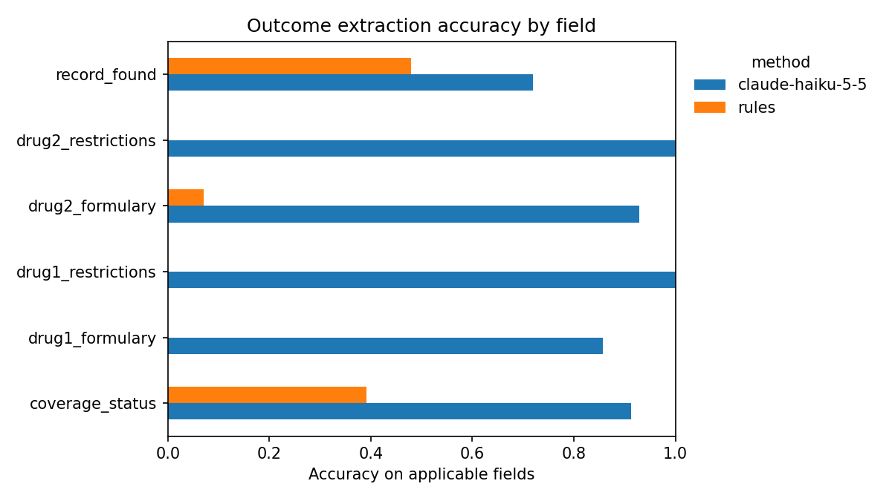
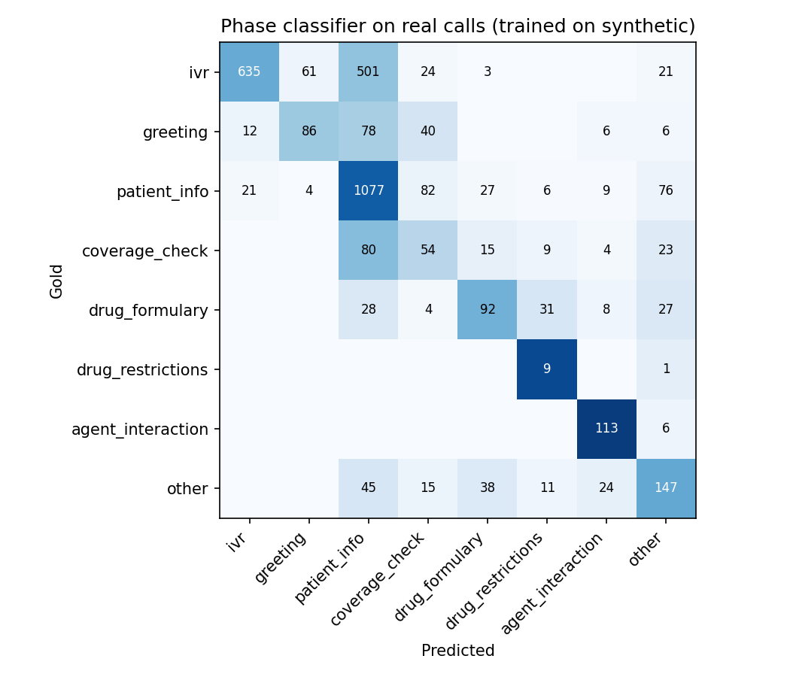

# Pharmacy Benefits-Call Intelligence

Can an LLM reliably pull the facts an operations team needs (patient found, coverage active, drug covered, prior authorization required) out of pharmacy benefits-verification calls, and is it worth the cost compared with a simple rules baseline? A second question: can a cheap classical model tag every turn of a call with its phase, and how well does a model trained on synthetic calls transfer to real ones?

Data: [INSURE-Dial](https://huggingface.co/datasets/dataframer/insure-dial) (EACL 2026): 50 annotated real and 1,000 synthetic insurance verification calls.

## Results (50 real calls, November 2026)

| Metric | Claude Haiku 5.5 | Rules baseline |
| --- | --- | --- |
| Field accuracy | **82%** (95% CI 70–91%) | 32% (95% CI 25–41%) |
| Calls fully correct | **70%** | 16% |
| Hallucination rate | **8.7%** | 12.8% |
| Median latency | 1.9 s per call | instant |
| Cost | ≈ $0.42 per 1,000 calls | ≈ $0 |

Phase classifier (TF-IDF + logistic regression): macro-F1 **0.88** in grouped cross-validation on synthetic calls, **0.52** on real calls, a 0.37 synthetic-to-real gap.




### What I learned

- **Read the failures before trusting the metric.** The first full run measured the LLM at 48%. Error analysis showed 15 of 50 replies were empty: the model spent its whole 400-token output budget reasoning before answering, and the parse check silently counted those as successes. Raising the budget and making the check honest moved measured accuracy to 82% with the same model.
- **Validate labels before scoring.** Inspecting the raw annotations revealed that coverage status lives under `plan_status` and that `"NA"` means not applicable; both were fixed before any results were reported.
- **Synthetic data overstates performance.** A classifier that looks strong on synthetic calls loses much of its accuracy on real ones, so real calls are the only fair final test.
- **Limitations.** 50 real calls is a small test set, so per-field results (especially fields that apply to few calls) are indicative, not definitive. `record_found` (72%) is the weakest field and is being investigated for label ambiguity.

## What it produces

| Output (in `reports/`) | What it shows |
| --- | --- |
| `summary.md` | All headline results in one page |
| `outcome_overall.csv` | Accuracy with 95% bootstrap CI, fully-correct-call rate, hallucination rate, latency, cost per 1,000 calls, per method |
| `outcome_accuracy_by_field.csv` / `.png` | Where each method succeeds and fails |
| `outcome_errors.csv` | Every wrong prediction, for error analysis |
| `phase_report_real.csv`, `phase_confusion_real.png` | Phase classifier trained on synthetic, tested on real |

## Run it

```bash
python -m venv .venv && source .venv/bin/activate     # Windows: .venv\Scripts\activate
pip install -r requirements.txt

python -m tests.smoke_test          # 1. confirm everything runs (stand-in data, ~10 s)
python -m src.data --download       # 2. download INSURE-Dial into data/ (gated: request access on Hugging Face, set HF_TOKEN)
python -m src.data --inspect        # 3. sanity-check the schema (see note below)
python run_all.py                   # 4. rules baseline + phase classifier, no API cost

cp .env.example .env                # 5. add your API key(s) to .env
python run_all.py --llm anthropic --limit 10     # 6. cheap smoke run on 10 calls
python run_all.py --llm anthropic --llm openai   # 7. full comparison on all 50 real calls
```

**Schema check (step 3).** Confirm that annotation `turn_range` values line up with the `turn` numbers in the script. If they line up with list positions instead (starting at 0), set `TURN_KEY = None` in `src/config.py`. Also confirm the coverage status lives at `annotation.coverage_check.value`; `src/data.py: gold_outcomes` is the one place to adjust if not.

**Cost.** LLM responses are cached in `cache/`, so re-running costs nothing. Add per-token prices in `src/config.py: PRICE_PER_MTOK` to get cost per 1,000 calls in the report.

## Project structure

```
src/config.py            fields, phases, models, prices
src/data.py              download, load, gold labels from annotations, turn-level phase labels
src/baseline_rules.py    keyword-rule extractor (the bar to beat)
src/llm_extract.py       prompt, Anthropic/OpenAI providers, caching, token + latency logging
src/phase_classifier.py  TF-IDF + logistic regression, grouped CV, synthetic-to-real test
src/evaluate.py          per-field accuracy, hallucination rate, call-level bootstrap CIs
run_all.py               runs everything and writes reports/
tests/                   stand-in data generator and end-to-end smoke test
```

## Method notes

- Gold labels follow the dataset's own business rules: coverage is scored only if the record was found; restrictions only if the drug is on formulary.
- Accuracy is computed only over fields that apply to a call. Producing a value for a field that doesn't apply is counted separately as a hallucination.
- Confidence intervals resample whole calls, because fields within a call are correlated.
- The phase classifier is evaluated with grouped cross-validation (no call split across folds) and then on real calls, so the gap measures domain shift rather than leakage.

## Next steps

1. Error analysis: read `outcome_errors.csv`, group errors by cause, revise the prompt, bump `PROMPT_VERSION`, re-run.
2. Prompt regression test: freeze a pass threshold per field and fail the run if a new prompt drops below it.
3. Cost/quality frontier: add a smaller and a larger model and plot accuracy against cost per 1,000 calls.
4. Fine-tune a small open model on the synthetic calls and compare with the prompted LLM on the real ones.

## Running in Google Colab

Open `notebooks/run_in_colab.ipynb` in Colab and run the cells in order. Store `HF_TOKEN` and `ANTHROPIC_API_KEY` as Colab secrets; never paste keys into cells.

## Data and licensing

INSURE-Dial is a gated dataset; this repository does not redistribute it. Request access on Hugging Face and download it with step 2 above.
